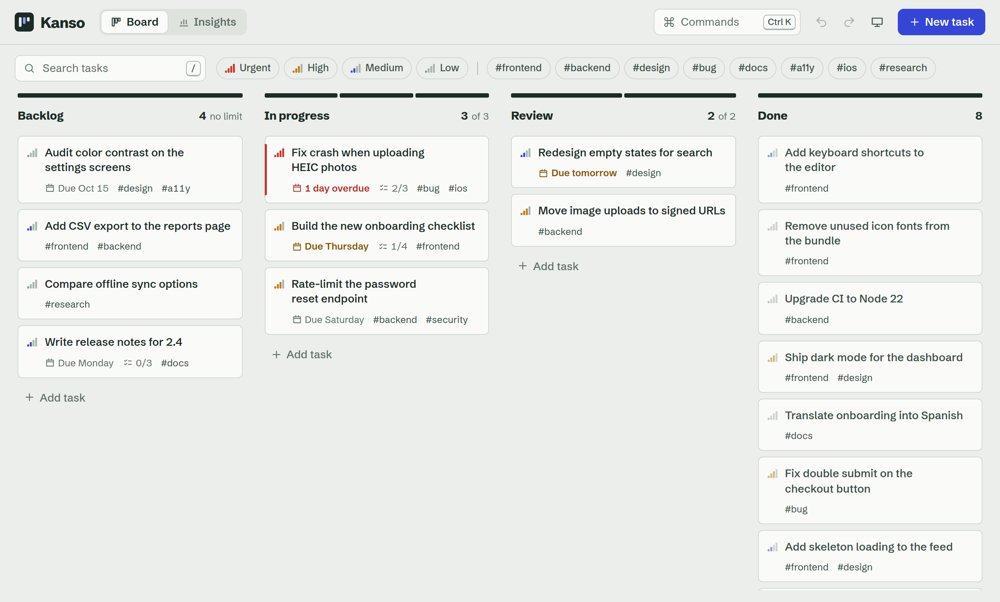
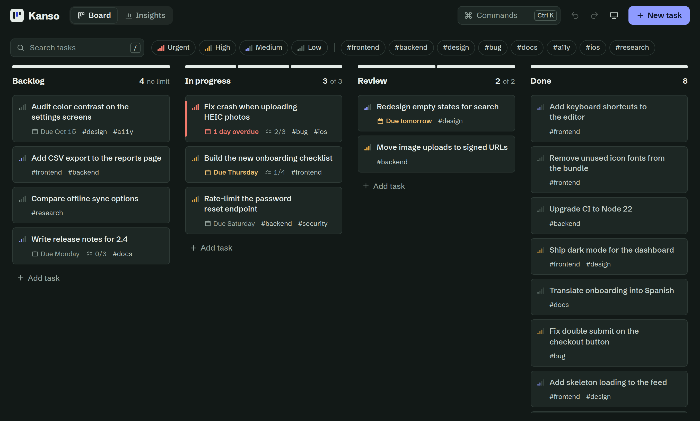
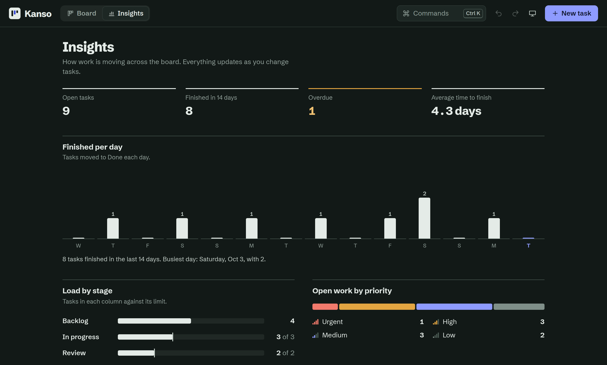

# Kanso

A fast, keyboard-friendly task board built with React. Drag cards between stages, set work-in-progress limits, find anything from a command menu, and see how work is moving on the insights page.

Built without UI or state libraries: drag and drop, undo history, fuzzy search, dialogs and charts are all written from scratch.

**Live demo:** _add your deployed link here_



## Features

- **Drag and drop that works everywhere.** One pointer-events implementation handles mouse, pen and touch. On touch screens you press and hold a card to lift it, so ordinary swipes still scroll the board. Columns and the board auto-scroll near their edges, and Escape cancels a drag.
- **Full keyboard support.** Focus a card and use Shift with the arrow keys to move it between columns or reorder it. Moves are announced to screen readers.
- **Command menu** (⌘K or Ctrl K) with ranked fuzzy search across actions and tasks.
- **Undo and redo for every change**, with labels such as "Undo: Task moved". Deleting a task shows a notification with an Undo button.
- **Work-in-progress limits.** Each column's top rule is a segmented meter. It turns hatched when a column is over its limit, and previews that state while you drag a card towards a full column.
- **Quick add with inline syntax.** `Fix login redirect #auth !high` creates a high-priority task tagged `auth`.
- **Filters** for text, priority and tags. Reordering stays correct while filters hide some cards.
- **Insights page** with tasks finished per day, load per stage, open work by priority, upcoming due dates and tag usage.
- **Light and dark themes** that follow the system by default, with no flash of the wrong theme on load.
- **Saved automatically** to local storage with schema versioning, plus JSON export and import.
- **Responsive.** On phones the columns snap one at a time and the task editor becomes a bottom sheet.

## Getting started

Requires Node 20.19 or later.

```bash
npm install
npm run dev       # start the dev server
npm test          # run the test suite once
npm run build     # production build in dist/
npm run preview   # serve the production build
```

## Keyboard shortcuts

| Keys | Action |
| --- | --- |
| ⌘K or Ctrl K | Open the command menu |
| N | Create a task |
| / | Search tasks |
| ⌘Z, ⇧⌘Z | Undo, redo |
| Shift + arrow keys | Move the focused card |
| ⌘Enter | Save the task being edited |
| ? | Show all shortcuts |

## How it's built

```
src/
  lib/          Pure logic with no React: reducer, history, filters, fuzzy search, dates, stats, storage
  state/        BoardProvider (reducer + history + persistence), toasts and screen-reader announcer
  hooks/        usePointerDrag, useHotkeys, useTheme, useStableCallback
  components/   Board, Column, TaskCard, TaskEditor, CommandPalette, Insights and smaller pieces
  styles/       Design tokens, base styles and one stylesheet per area
```

### Decisions worth knowing about

**State is one immutable reducer wrapped in a history layer.** `boardReducer` is pure and returns the same object when an action changes nothing. `withHistory` is a higher-order reducer that stores previous snapshots with a label for each change. Because updates share structure, a snapshot costs very little memory, and no-op actions never create empty undo steps. Editing a task and changing its status is a single `task/save` action, so it undoes in one step.

**Drag and drop avoids re-rendering on every pointer move.** The floating card is positioned through a ref inside a `requestAnimationFrame` loop. React state only changes when the drop target (column or position) actually changes, so a drag across a busy board stays smooth. Drop positions are calculated against the visible cards and then mapped back to the full list (`resolveDropIndex`), which keeps reordering correct while filters are active.

**Native `<dialog>` for every modal.** The browser provides the focus trap, Escape handling, inert background and stacking. A small wrapper adds backdrop-click closing (only when the press both starts and ends on the backdrop) and restores focus when a dialog closes.

**Stable handlers for memoized cards.** `useStableCallback` gives event handlers a fixed identity that always calls the latest logic, so `TaskCard` stays memoized while the board re-renders around it.

**Design tokens in CSS custom properties.** Every color is a token, redefined once for dark mode. Priority is shown as signal-strength bars, so it is readable from shape as well as color.

### Accessibility

Columns are labelled regions and cards are buttons with instructions attached through `aria-describedby`. The command menu follows the combobox and listbox pattern with `aria-activedescendant`. The insights chart has an equivalent data table for screen readers. Focus is always visible, the layout respects `prefers-reduced-motion`, and text meets WCAG AA contrast in both themes.

### Testing

Vitest and Testing Library. The pure modules (reducer, history, filters, fuzzy matching, dates, storage) have unit tests. Integration tests render the whole app and cover searching, quick add with undo, keyboard moves, the command menu and editing a task. CI runs the tests and a production build on every push.

## What I'd add next

- Shared boards with a small backend and optimistic updates
- Editable and reorderable columns
- An animated settle when a card is dropped, using the FLIP technique
- End-to-end tests for drag and drop with Playwright

## Screenshots




